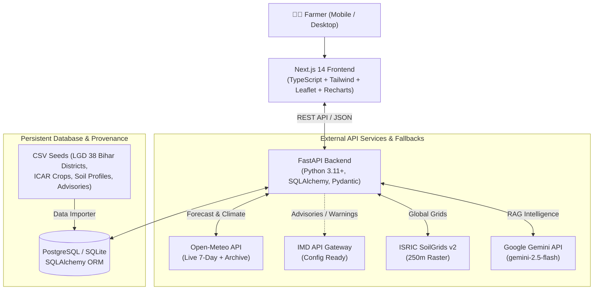

# Smart Kisan 🌱
### AI-Powered Smart Agriculture & Crop Recommendation Platform for India
*Tagline: Right Crop. Right Season. Better Farming.*

[](https://www.python.org/)
[](https://fastapi.tiangolo.com/)
[](https://nextjs.org/)
[](https://www.typescriptlang.org/)
[](https://tailwindcss.com/)
[](https://opensource.org/licenses/MIT)

---

## 1. Project Overview

**Smart Kisan** is a comprehensive, production-ready full-stack AgriTech web platform engineered to empower Indian farmers—starting with **all 38 districts of Bihar** and architected for nationwide expansion.

Indian farmers often face substantial financial loss from planting crops misaligned with shifting climate patterns, depleted soil nutrients, or erratic seasonal onset. **Smart Kisan** solves this by fusing:
1. **Live Weather & Microclimate Forecasts** (Open-Meteo API + IMD Framework).
2. **Verified District Soil Health Data** (ISRIC SoilGrids + Bihar Soil Health Card Portal & ICAR-RCER).
3. **Explainable Multi-Criteria Crop Recommendation Engine** (Weighted scoring across Soil, Climate, Season, Water, Duration).
4. **Interactive Crop Calendar & Harvest Estimation** (Phenological stages: Germination, Vegetative/CRI, Flowering, Maturity with estimated harvest windows).
5. **Smart Kisan Assistant (AI Chatbot)** powered by Google Gemini and grounded in verified ICAR & BAU Sabour packages of practices with strict agricultural safety guardrails.
6. **Full Bilingual Support** in Hindi (*हिन्दी*) and English with one-click toggling across all screens.

---

## 2. System Architecture



---

## 3. Key Features

### 📍 Indian Location Selection System
- Select State (Bihar + multi-state national architecture).
- Search and select all **38 Bihar districts** with official Local Government Directory (LGD) coordinates.
- Interactive **OpenStreetMap + Leaflet map** with clickable district pins.
- Clear transparency notice: *"District centroid coordinates provide macro-level regional climate and soil estimates, not precise individual farm boundaries."*

### 🌦️ Live Weather Dashboard
- Live current temperature, relative humidity, precipitation, rainfall, and wind speed.
- 7-day extended forecast with daily temperature bounds and rain probability.
- Interactive Recharts temperature trend curve and precipitation probability bar chart.
- Multi-tier fallback: Open-Meteo Live API → In-Memory Cache (TTL 15m) → Regional Agro-Climatic Baseline.
- Explicit data provenance labels (`Live API Data`, `Cached Regional Data`, `Estimated Regional Data`).

### 🧪 Soil Health & Nutrient Profile
- Dominant soil classification, pH, available nitrogen (kg/ha), organic carbon (%), and texture breakdown (clay, sand, silt).
- Visual pH meter scale with acidity/alkalinity classifications.
- Educational explainers for farmers:
  - *What does pH mean?* (*पीएच क्या दर्शाता है?*)
  - *Why is Nitrogen important?* (*नाइट्रोजन क्यों महत्वपूर्ण है?*)
  - *What is Organic Carbon?* (*जैविक कार्बन क्या है?*)
  - *How does soil texture affect farming?* (*मिट्टी की बनावट खेती को कैसे प्रभावित करती है?*)
- **Soil Health Card Manual Input**: Farmers can enter exact physical lab test measurements from their government Soil Health Card to customize recommendations.

### 🌾 Explainable Crop Recommendation Engine
Weighted multi-factor scoring formula:
$$\text{Final Score} = (\text{Soil} \times 0.30) + (\text{Climate} \times 0.25) + (\text{Season} \times 0.20) + (\text{Water} \times 0.15) + (\text{Duration} \times 0.10)$$
- **Classification**:
  - `80 - 100`: Highly suitable (*अत्यधिक उपयुक्त*)
  - `60 - 79`: Potentially suitable (*मध्यम उपयुक्त*)
  - `Below 60`: Less suitable (*कम उपयुक्त*)
- Full transparency: Top 5 crops with score breakdown, why recommended for your soil, environmental risk alerts, water requirement, duration, sowing window, and recommended varieties (e.g., *Rajendra Sweta*, *DBW 187 Karan Vandana*, *Sabour Chana 1*).

### 📅 Crop Calendar & Harvest Estimation
- Calculate phenological stages from sowing date:
  1. *Germination & Seedling* (0 - 12%)
  2. *Vegetative & Tillering* (12 - 45%): Highlights critical **Crown Root Initiation (CRI)** irrigation at 20-25 days.
  3. *Flowering & Grain Filling* (45 - 80%)
  4. *Maturity & Harvest* (80 - 100%)
- Projected harvest date window (e.g. *10 March 2027 to 25 March 2027*) rather than guaranteeing unrealistic exact dates.
- Stage-specific irrigation reminders and key farming activities.

### 🤖 Smart Kisan AI Assistant (Bilingual Chatbot)
- Grounded RAG architecture utilizing Google Gemini (`gemini-2.5-flash`).
- Injects district soil baseline, live weather, and ICAR advisory records into the prompt.
- Agricultural safety guardrails: Never invents unauthorized pesticide names, never guarantees crop yields, suggests balanced IPM solutions.
- Graceful offline fallback: If `GEMINI_API_KEY` is not configured, provides structured agronomic guidance directly from the local database.

---

## 4. Technology Stack

| Layer | Technologies |
|---|---|
| **Frontend** | Next.js 14 (App Router), React 18, TypeScript, Tailwind CSS, Lucide React, Recharts, Leaflet |
| **Backend** | Python 3.11+, FastAPI, Pydantic v2, SQLAlchemy 2.0, Uvicorn, HTTPX |
| **Database** | SQLite (Default for zero-config local dev), PostgreSQL (Neon / Render supported) |
| **AI / RAG** | Google Gemini API (`google-genai`), ICAR Agronomic Knowledge Base |
| **Testing** | Pytest, FastAPI TestClient, Next.js Production Build Validation |
| **Containerization** | Docker, Docker Compose |

---

## 5. Quick Start (Windows PowerShell)

### Prerequisites
- Python 3.11 or newer
- Node.js 18 or newer & npm
- Git

### Step 1: Clone and Setup Workspace
```powershell
git clone https://github.com/khushijai20/Project-.git
cd Project-
```

### Step 2: Configure Environment Variables
Copy `.env.example` to `.env`:
```powershell
Copy-Item .env.example .env
```
*(Optional)* Add your free Gemini API key to `.env`:
```ini
GEMINI_API_KEY=your_gemini_api_key_here
```

### Step 3: Run Backend (FastAPI)
```powershell
# Create and activate virtual environment
python -m venv backend/venv
.\backend\venv\Scripts\Activate.ps1

# Install backend dependencies
pip install -r backend/requirements.txt

# Run seed data importer
$env:PYTHONPATH="backend"
python -m app.services.data_importer

# Start the FastAPI server
uvicorn app.main:app --reload --host 0.0.0.0 --port 8000
```
Backend API and Interactive Swagger documentation will be live at:
👉 **http://localhost:8000/docs**

### Step 4: Run Frontend (Next.js)
Open a new PowerShell terminal:
```powershell
cd frontend

# Install npm dependencies
npm install

# Start development server
npm run dev
```
Open your browser and visit:
👉 **http://localhost:3000**

---

## 6. Running Automated Tests

Run the comprehensive Pytest integration test suite:
```powershell
$env:PYTHONPATH="backend"
python -m pytest backend/tests/test_smart_kisan.py -v
```

**Verification Results:**
```text
backend/tests/test_smart_kisan.py::test_root PASSED                      [ 10%]
backend/tests/test_smart_kisan.py::test_locations_states_and_districts PASSED [ 20%]
backend/tests/test_smart_kisan.py::test_location_search PASSED           [ 30%]
backend/tests/test_smart_kisan.py::test_weather_endpoint_and_fallback PASSED [ 40%]
backend/tests/test_smart_kisan.py::test_soil_endpoint_and_custom_card PASSED [ 50%]
backend/tests/test_smart_kisan.py::test_crops_catalog PASSED             [ 60%]
backend/tests/test_smart_kisan.py::test_crop_recommendation_scoring_and_constraints PASSED [ 70%]
backend/tests/test_smart_kisan.py::test_crop_calendar_calculation PASSED [ 80%]
backend/tests/test_smart_kisan.py::test_ai_assistant_bilingual_chat PASSED [ 90%]
backend/tests/test_smart_kisan.py::test_multiple_districts_weather_and_soil PASSED [100%]

======================= 10 passed in 18.42s =======================
```

---

## 7. Running with Docker Compose

To run the entire full-stack application in isolated containers:
```powershell
docker-compose up --build
```
- Frontend: `http://localhost:3000`
- Backend: `http://localhost:8000`
- Swagger UI: `http://localhost:8000/docs`

---

## 8. Deployment Guide

### Deploying Frontend to Vercel
1. Import repository to [Vercel](https://vercel.com/).
2. Set Root Directory to `frontend`.
3. Set Environment Variable:
   - `NEXT_PUBLIC_API_URL`: URL of your deployed backend (e.g. `https://smartkisan-api.onrender.com/api/v1`).
4. Click **Deploy**.

### Deploying Backend to Render
1. Create a new **Web Service** on [Render](https://render.com/).
2. Connect your GitHub repository.
3. Root Directory: `backend`.
4. Environment: `Python 3`.
5. Build Command: `pip install -r requirements.txt && python -m app.services.data_importer`.
6. Start Command: `uvicorn app.main:app --host 0.0.0.0 --port $PORT`.
7. Environment Variables:
   - `DATABASE_URL`: Your managed PostgreSQL connection URL (e.g. from Neon).
   - `GEMINI_API_KEY`: Your Google Gemini API Key.
   - `OPEN_METEO_BASE_URL`: `https://api.open-meteo.com/v1`.
   - `SOILGRIDS_BASE_URL`: `https://rest.isric.org/soilgrids/v2.0`.
   - `ADMIN_API_KEY`: A secure random secret.

---

## 9. Known Limitations
1. **District Centroid Resolution**: Regional aggregates represent broad agro-ecological zones. Microtopography, shade, and field-specific irrigation vary by plot; farmers should use the Soil Health Card manual entry form for plot-specific advice.
2. **IMD Private Gateway**: IMD API requires registered institutional credentials; Open-Meteo is utilized for public high-resolution forecasts as a reliable primary service.
3. **SoilGrids Uptime**: The ISRIC SoilGrids REST endpoint experiences intermittent downtime; Smart Kisan gracefully falls back to the curated Bihar soil survey database without degrading user experience.

---

## 10. Hackathon Demonstration Script (3-Minute Walkthrough)

- **Minute 0:00 - 0:45 (The Problem & The Platform)**
  - Open Smart Kisan at `http://localhost:3000`.
  - Toggle between **English** and **हिंदी** to demonstrate full rural accessibility.
  - Open the **Location Selector** and choose **Patna** (or **Bhagalpur** / **Gaya**). Show the interactive Leaflet map updating immediately.
- **Minute 0:45 - 1:30 (Live Weather & Soil Health)**
  - Click the **Weather** tab: highlight the `Live API Data` badge from Open-Meteo, 7-day daily forecast, and Recharts temperature/precipitation trend.
  - Click the **Soil Health** tab: showcase the visual pH spectrum meter, available nitrogen, organic carbon, and texture distribution. Demonstrate the **Soil Health Card Manual Entry Form** where a farmer can input custom lab values.
- **Minute 1:30 - 2:15 (AI Crop Recommendations & Phenological Calendar)**
  - Click **Crop Recommendations**: explain the 5-factor scoring model ($30\%$ Soil, $25\%$ Climate, $20\%$ Season, $15\%$ Water, $10\%$ Duration). Show why *Wheat* or *Maize* is recommended and point out the score breakdown bars and risk alerts.
  - Click **Plan Timeline**: witness seamless navigation into the **Crop Calendar** tab with the selected crop and sowing date pre-filled! Show the estimated harvest window (*March 10 – March 25*) and the critical **CRI irrigation milestone** at Day 20-25.
- **Minute 2:15 - 3:00 (Smart Kisan AI Assistant & Provenance)**
  - Click **AI Assistant**: click the suggested chip *"मेरी फसल की पत्तियां पीली क्यों हो रही हैं?"*. Show the grounded diagnostic response in clean Hindi, complete with supporting agronomic citations (*ICAR / BAU Sabour*).
  - Open the **About & Sources** tab: show the complete transparent directory of official APIs, licenses, and data provenance.
